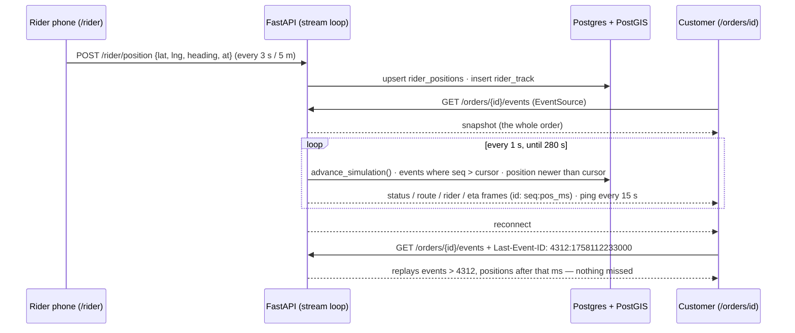

# Platter

**Hot food, tracked to your door.** A four-sided food-delivery platform for one Bengaluru neighbourhood (Koramangala + HSR Layout): customers order from kitchens that can actually reach them, restaurants run a live order board, riders get dispatched and share their GPS from a phone, and an admin sees every order and rider on one map — and the rider moves on the customer's map in real time.

> Status: **v1 Kitchen built** (milestones 1.0–1.2). One of six portfolio projects by [Viraj Domadia](https://virajdomadia.com). Live: https://platter.virajdomadia.com

## Try it
Every side has a one-tap demo login on the home page and `/sign-in`:

| Demo | What you land on |
|---|---|
| 🙂 **Customer** (Ananya) | Three saved addresses and an order already on the way — the route draws itself and the rider glides along real streets |
| 🍳 **Restaurant** (Koramangala Social) | The kitchen board on a tablet: tickets print with a chime; Accept dispatches the nearest rider |
| 🛵 **Rider** (Divya) | A phone PWA with a job assigned. Switch on *Share my location* and walk — the customer's map walks with you (outside Bengaluru, *relay mode* replays your steps in Koramangala) |
| 🗺️ **Admin** | Every active order and rider on one map, stuck flags, reassign |

Eight riders are simulated (no process: a sim's position is computed from its route and the clock whenever anyone looks), and while nobody is on a restaurant's board a *kitchen autopilot* accepts and cooks its orders — so an order placed from any kitchen is delivered with no human action. The demo rider is real.

## What it proves
- **PostGIS**: restaurants within 5 km of a pin (`ST_DWithin`, GIST), nearest available rider by KNN with `skip locked`.
- **A role-guarded state machine**: `placed → accepted → preparing → ready → picked_up → delivered` (+ rejected, cancelled, expired), one `transition()` under a row lock, 409 for anything else.
- **Live location over SSE with Postgres as the bus** — no WebSockets, no Pusher, ₹0 per order: MapLibre + OpenFreeMap, OSRM routes, Photon geocoding.

## How the bus works
Every status change appends a row to `order_events` (commit-ordered `seq`: each insert takes `pg_advisory_xact_lock(1)` after its row locks). Riders POST GPS fixes into `rider_positions`. One stream loop in `api/app/services/stream.py` serves four scopes (order, restaurant, rider, admin): every second it advances the lazy simulation for its scope, reads `order_events where seq > $cursor` and positions newer than its position cursor, and yields SSE frames with `id: {seq}:{pos_ms}`. It closes itself at 280 s; the browser reconnects with `Last-Event-ID` and the loop replays exactly what was missed — `order_events` is the durable log, so a dropped connection loses nothing.



v1 polls the log once a second. v3 adds `LISTEN/NOTIFY` purely as a wake-up for the same read (the log stays the source of truth) and publishes measured latency. ETAs are remaining prep + the remaining route at the rider's own speed; v3's ETA range is *measured from our own history* (average ± 1 SD of the restaurant's last 20 orders) — never "learned".

## Stack
Next.js 15 (App Router) · TypeScript · Tailwind 4 · MapLibre GL + OpenFreeMap · FastAPI (Python 3.12, uv) · SQLAlchemy 2 async + GeoAlchemy2 + Alembic · Neon Postgres + PostGIS · SSE · OSRM · Photon · Razorpay (test mode) · Vercel (built on GitHub Actions)

## Repo
```
api/   FastAPI — app/{core,models,schemas,routers,services,seed}, alembic/, tests/ (62 tests, PostGIS), scripts/
web/   Next.js — app/(site) customer · (restaurant) board · (rider) PWA · (admin) map; components/; lib/; tests/
docs/  03 requirements + flows · 04 technical design + UI · 05 architecture · 06 data + API · 07 plan · 12 security + performance
```

## Run locally
Needs Postgres with PostGIS (e.g. `docker run -p 5432:5432 -e POSTGRES_HOST_AUTH_METHOD=trust postgis/postgis:17-3.5`), [uv](https://docs.astral.sh/uv/) and pnpm.
```bash
# api
cd api
uv sync
export DB=postgresql+asyncpg://postgres@localhost:5432/platter
ALEMBIC_URL=$DB uv run alembic upgrade head
SEED_DATABASE_URL=$DB uv run python -m app.seed.seed      # add --offline to skip OSRM
DATABASE_URL=$DB uv run uvicorn app.main:app --port 8000  # /docs for the API
TEST_DATABASE_URL=postgresql+asyncpg://postgres@localhost:5432/platter_test uv run pytest

# web (another terminal)
cd web
pnpm install
API_URL=http://localhost:8000 pnpm dev                    # http://localhost:3000
pnpm lint && pnpm exec tsc --noEmit && pnpm test
```
`pnpm gen:api` regenerates `web/src/lib/api-types.ts` from the API's OpenAPI schema.

## Deploy
Both apps deploy from GitHub Actions only (`.github/workflows/vercel.yml`, after CI passes on `main`): the api (`platter-api`) first, then the web. Vercel's own Git builds are off. Migrations are a deliberate manual step before merging a schema change: `ALEMBIC_URL=<neon direct url> uv run alembic upgrade head`.

## Planning
[PRD](PRD.md) · [Plan](docs/07-plan.md) · [Tracker](https://claude.ai/artifact/HEHpyrigHuZpBMoECDs4qG) · [Screens](https://claude.ai/artifact/GGchE2CjZ7DN5t83pzs9Cu) · Dish photos: Wikimedia Commons, credited in `web/public/dishes/CREDITS.md`.

Roadmap: v1 Kitchen → v2 Rush (rider offers, Web Push, menu editor, ledgers) → v3 Fleet (batching, measured ETA, LISTEN/NOTIFY, native Expo rider app) → v4 Order together.
